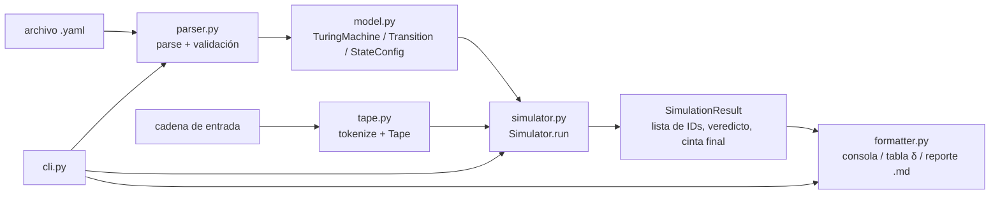

# Arquitectura del simulador

El simulador está escrito en Python 3 y separa en módulos cada responsabilidad del
enunciado: **parsing de la MT**, **parsing de la cinta**, **estructuras de datos**,
**simulación** y **visualización de descripciones instantáneas (IDs)**.



## Módulos

| Módulo | Responsabilidad |
|---|---|
| `mt_simulator/model.py` | Estructuras de datos inmutables: `StateConfig` (estado compuesto `[q, m]`), `Transition` (una regla δ) y `TuringMachine` (la 7-tupla `M = (Q, Σ, Γ, δ, q0, B, F)` + cadenas a simular). La δ se guarda en un diccionario `(estado, memoria, símbolo) → Transition`, así cada paso es O(1). |
| `mt_simulator/parser.py` | Lee el YAML con `yaml.safe_load` y valida: campos obligatorios, estados existentes, `Σ ⊆ Γ`, `B ∈ Γ` y `B ∉ Σ`, símbolos de cada transición en Γ, movimientos `L/R/S` y **determinismo** (no puede haber dos δ con la misma llave). Junta *todos* los errores en un solo `MTParseError` para que el usuario los vea de una vez. |
| `mt_simulator/tape.py` | `tokenize` convierte la cadena de entrada en símbolos (carácter por carácter, por espacios o por *longest match* si hay símbolos de varios caracteres) y rechaza símbolos fuera de Σ. `Tape` es una cinta **infinita en ambas direcciones** implementada como `dict[int, str]`: solo se guardan las celdas no blancas, por lo que mover el cabezal fuera del contenido no cuesta nada. |
| `mt_simulator/simulator.py` | `Simulator.run(cadena)` ejecuta la MT y produce un `SimulationResult` con la lista completa de `InstantaneousDescription`. |
| `mt_simulator/formatter.py` | Presentación: descripción formal, tabla de transiciones en notación δ, IDs encadenadas con `⊢`, tabla resumen y reporte Markdown. |
| `mt_simulator/cli.py` | Interfaz de línea de comandos (`python -m mt_simulator`). |

## Estado con memoria (almacenamiento en el control finito)

El formato del enunciado define cada transición con pares:

```yaml
- state: q0
  read:  [a, B]   # [símbolo en la cinta, símbolo en memoria]
  write: [a, B]   # [nueva memoria, símbolo que se escribe en la cinta]
  move: R
  next: q1
```

que corresponde a `δ([q0, B], a) = ([q1, a], B, R)`. Es la técnica de
*almacenamiento en el estado* (Hopcroft, Motwani y Ullman §8.3.1): el estado de la
MT es el par `[q, m]` y `m` guarda un símbolo de Γ. La memoria inicial siempre es el
blanco, `[q0, B]`. La MT reconocedora del proyecto usa esta memoria para "cargar" un
símbolo de la primera mitad de la cadena hasta la segunda mitad.

Como atajo, `read: a` equivale a `[a, B]` y `write: X` equivale a `[B, X]`.

## Algoritmo de simulación

```text
config ← [q0, B];  cinta ← entrada;  IDs ← [ID inicial]
repetir:
    si config.q ∈ F            → ACEPTA   (la MT se detiene)
    t ← δ(config.q, config.m, cinta.leer())
    si t no existe              → RECHAZA  (se detuvo fuera de F)
    si pasos ≥ max_steps        → RECHAZA  (posible ciclo infinito)
    cinta.escribir(t.write_symbol); cinta.mover(t.move)
    config ← [t.next, t.write_memory]
    IDs.agregar(ID actual)
```

* La MT es **determinista**: el parser garantiza que exista a lo sumo una δ por configuración.
* El límite de pasos (`--max-steps`, 100 000 por defecto) evita que una MT que no se
  detiene congele el programa. En ese caso se reporta que no se alcanzó un estado de aceptación.

## Descripciones instantáneas

Una ID se escribe como en el libro, `α [q, m] β`: `α` es lo que está a la
izquierda del cabezal, el estado va justo antes del símbolo que se está leyendo y `β`
es el resto de la cinta. Se omiten los blancos de los extremos excepto el que está
bajo el cabezal. Ejemplo (reconocedora ww):

```text
  0   [q0, B]abaaba
  1 ⊢ x[q1, B]baaba      (δ([q0, B], a) = ([q1, B], x, R))
  ...
 39 ⊢ Z[q7, a]yxaba      (δ([q6, B], x) = ([q7, a], Z, R))   ← la 'a' viaja en la memoria
 40 ⊢ Zy[q7, a]xaba      (δ([q7, a], y) = ([q7, a], y, R))
```

Cada ID guarda también la transición que la produjo, para mostrarla al lado.

## Pruebas

`tests/` contiene pruebas con `pytest` del parser, la cinta, el simulador y las dos MT
entregadas. Las MT se verifican **exhaustivamente**: la reconocedora contra todas las
cadenas de `{a,b}` hasta longitud 10 (2 047 cadenas) y la alteradora contra todas las
sumas `a + b` con `0 ≤ a, b < 20`.
