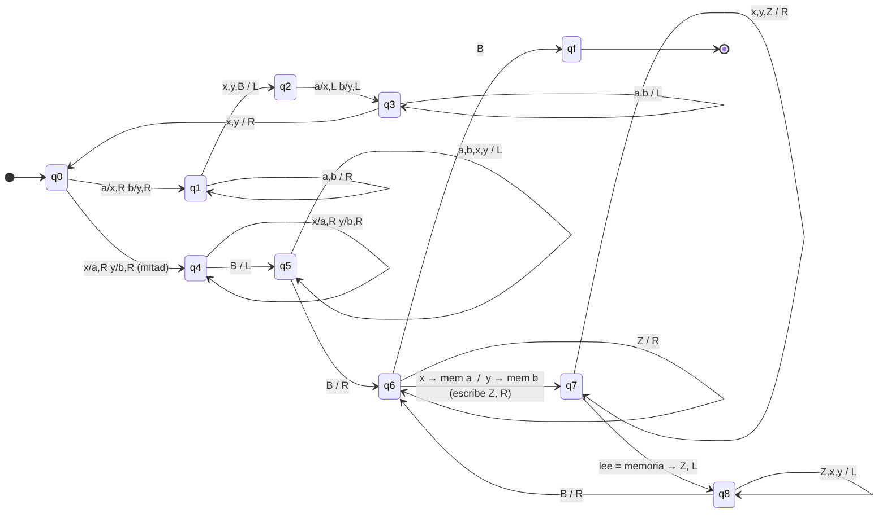
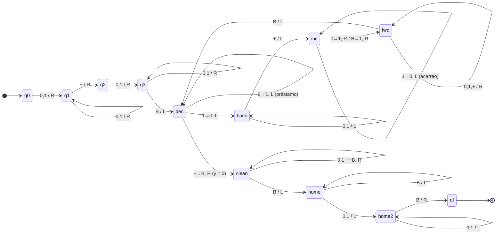

# Máquinas de Turing del proyecto

Las tablas completas de transiciones (con cada ID de cada cadena) están en
[`salidas/`](../salidas). Notación: `δ([q, m], s) = ([p, m'], s', D)`.

---

## 1. MT reconocedora — L = { ww | w ∈ {a,b}⁺ }

Archivo: [`maquinas/reconocedora_ww.yaml`](../maquinas/reconocedora_ww.yaml)

**Por qué es difícil:** `L` **no es libre de contexto** (por el lema de bombeo para
LLC), así que ningún autómata de pila lo reconoce. La MT primero tiene que *encontrar
la mitad* de la cadena sin saber su longitud, y luego *comparar* posición por posición
ambas mitades. Para comparar usa la **memoria del control finito**: el símbolo que se
toma de la primera mitad viaja dentro del estado (`[q7, a]` o `[q7, b]`).

| Componente | Valor |
|---|---|
| Q | {q0, q1, q2, q3, q4, q5, q6, q7, q8, qf} |
| Σ | {a, b} |
| Γ | {a, b, x, y, Z, B} |
| Estado inicial | [q0, B] |
| F | {qf} |
| Transiciones | 39 |

Significado de los símbolos de cinta: `x`/`y` = `a`/`b` marcada; `Z` = símbolo ya comparado.

### Estados

| Estado | Función |
|---|---|
| q0 | Marca el símbolo no marcado más a la izquierda (a→x, b→y). Si encuentra uno ya marcado, llegó a la mitad. |
| q1 | Avanza a la derecha hasta el final de la zona no marcada. |
| q2 | Marca el símbolo no marcado más a la derecha. Si no hay (lee x/y) la longitud es impar → **rechaza**. |
| q3 | Regresa a la izquierda hasta la última marca. |
| q4 | Desmarca la segunda mitad (x→a, y→b) para distinguirla de la primera. |
| q5 | Regresa al inicio de la cinta. |
| q6 | Salta las `Z`; toma el siguiente `x`/`y` de la primera mitad, lo guarda en memoria y lo tacha con `Z`. Si ya no hay (lee B) → **acepta**. |
| q7 | Con `a` o `b` en memoria, avanza hasta el primer `a`/`b` de la segunda mitad. Si coincide lo tacha con `Z`; si no, **rechaza**. |
| q8 | Regresa al inicio para la siguiente comparación. |

### Transiciones

| Estado | Lee | → Estado | Escribe | Mov |
|---|---|---|---|---|
| [q0, B] | a | [q1, B] | x | R |
| [q0, B] | b | [q1, B] | y | R |
| [q0, B] | x | [q4, B] | a | R |
| [q0, B] | y | [q4, B] | b | R |
| [q1, B] | a / b | [q1, B] | a / b | R |
| [q1, B] | x / y / B | [q2, B] | x / y / B | L |
| [q2, B] | a | [q3, B] | x | L |
| [q2, B] | b | [q3, B] | y | L |
| [q3, B] | a / b | [q3, B] | a / b | L |
| [q3, B] | x / y | [q0, B] | x / y | R |
| [q4, B] | x | [q4, B] | a | R |
| [q4, B] | y | [q4, B] | b | R |
| [q4, B] | B | [q5, B] | B | L |
| [q5, B] | a / b / x / y | [q5, B] | (igual) | L |
| [q5, B] | B | [q6, B] | B | R |
| [q6, B] | Z | [q6, B] | Z | R |
| [q6, B] | x | **[q7, a]** | Z | R |
| [q6, B] | y | **[q7, b]** | Z | R |
| [q6, B] | B | [qf, B] | B | S |
| [q7, a] | x / y / Z | [q7, a] | (igual) | R |
| [q7, a] | a | [q8, B] | Z | L |
| [q7, b] | x / y / Z | [q7, b] | (igual) | R |
| [q7, b] | b | [q8, B] | Z | L |
| [q8, B] | Z / x / y | [q8, B] | (igual) | L |
| [q8, B] | B | [q6, B] | B | R |

### Cadenas para el video (longitud ≥ 5)

| Cadena | w | Resultado | Pasos | Motivo |
|---|---|---|---:|---|
| `abaaba` | aba | ACEPTADA | 75 | |
| `babbbabb` | babb | ACEPTADA | 119 | |
| `aabbaabb` | aabb | ACEPTADA | 119 | |
| `abaab` | — | RECHAZADA | 20 | longitud impar: no existe δ([q2, B], x) |
| `abbaab` | — | RECHAZADA | 50 | `abb` ≠ `aab`: en la 2.ª comparación la memoria trae `b` y encuentra `a` |
| `aabbab` | — | RECHAZADA | 41 | `aab` ≠ `bab`: en la 1.ª comparación la memoria trae `a` y encuentra `b` |

---

## 2. MT alteradora — suma binaria `x+y → x+y`

Archivo: [`maquinas/alteradora_suma_binaria.yaml`](../maquinas/alteradora_suma_binaria.yaml)

**Qué hace:** recibe dos números binarios separados por `+` y deja en la cinta **solo
el resultado** de la suma, por ejemplo `1011+110` → `10001` (11 + 6 = 17). La forma de
la cinta cambia por completo: se borra `+y` y `x` puede crecer hacia la izquierda.

**Por qué es difícil:** implementa aritmética binaria con únicamente movimientos de un
cabezal: un **decremento con préstamo** sobre `y` y un **incremento con acarreo** sobre
`x` (que puede desbordarse y agregar un dígito nuevo a la izquierda), repetidos hasta
que `y = 0`; además valida la forma de la entrada y limpia la cinta al final.

| Componente | Valor |
|---|---|
| Q | {q0, q1, q2, q3, dec, back, inc, fwd, clean, home, home2, qf} |
| Σ | {0, 1, +} |
| Γ | {0, 1, +, B} |
| Estado inicial | [q0, B] |
| F | {qf} |
| Transiciones | 32 |

### Estados

| Estado | Función |
|---|---|
| q0–q3 | Validan la forma `x+y` (al menos un dígito a cada lado, un solo `+`) y llevan el cabezal al final de `y`. |
| dec | `y := y − 1`. `0→1` y sigue a la izquierda (préstamo); `1→0` y termina. Si llega a `+` con préstamo, `y` valía 0 → limpiar. |
| back | Regresa hasta el `+`. |
| inc | `x := x + 1`. `1→0` y sigue a la izquierda (acarreo); `0→1` termina; si lee `B` escribe `1` (x crece). |
| fwd | Vuelve al final de `y` para el siguiente decremento. |
| clean | Borra el `+` y lo que queda de `y`. |
| home, home2 | Regresan el cabezal al inicio del resultado y aceptan en qf. |

### Transiciones

| Estado | Lee | → Estado | Escribe | Mov |
|---|---|---|---|---|
| [q0, B] | 0 / 1 | [q1, B] | 0 / 1 | R |
| [q1, B] | 0 / 1 | [q1, B] | 0 / 1 | R |
| [q1, B] | + | [q2, B] | + | R |
| [q2, B] | 0 / 1 | [q3, B] | 0 / 1 | R |
| [q3, B] | 0 / 1 | [q3, B] | 0 / 1 | R |
| [q3, B] | B | [dec, B] | B | L |
| [dec, B] | 0 | [dec, B] | 1 | L |
| [dec, B] | 1 | [back, B] | 0 | L |
| [dec, B] | + | [clean, B] | B | R |
| [back, B] | 0 / 1 | [back, B] | 0 / 1 | L |
| [back, B] | + | [inc, B] | + | L |
| [inc, B] | 1 | [inc, B] | 0 | L |
| [inc, B] | 0 | [fwd, B] | 1 | R |
| [inc, B] | B | [fwd, B] | 1 | R |
| [fwd, B] | 0 / 1 / + | [fwd, B] | 0 / 1 / + | R |
| [fwd, B] | B | [dec, B] | B | L |
| [clean, B] | 0 / 1 | [clean, B] | B | R |
| [clean, B] | B | [home, B] | B | L |
| [home, B] | B | [home, B] | B | L |
| [home, B] | 0 / 1 | [home2, B] | 0 / 1 | L |
| [home2, B] | 0 / 1 | [home2, B] | 0 / 1 | L |
| [home2, B] | B | [qf, B] | B | R |

### Cadenas para el video (longitud ≥ 5)

| Entrada | Operación | Cinta final | Pasos |
|---|---|---|---:|
| `101+11` | 5 + 3 = 8 | `1000` | 53 |
| `1011+110` | 11 + 6 = 17 | `10001` | 101 |
| `111+111` | 7 + 7 = 14 | `1110` | 109 |
| `1+1111` | 1 + 15 = 16 | `10000` | 238 |
| `1100+0` | 12 + 0 = 12 | `1100` | 18 |

Las entradas mal formadas (`+1`, `1+`, `1+1+1`, …) se rechazan porque no existe
transición para ellas.

---

## Ejemplos adicionales

* [`maquinas/ejemplos/ejemplo_enunciado.yaml`](../maquinas/ejemplos/ejemplo_enunciado.yaml):
  el YAML del enunciado tal cual, para comprobar el formato `read`/`write` con memoria.
* [`maquinas/ejemplos/anbn.yaml`](../maquinas/ejemplos/anbn.yaml): reconocedora clásica
  `{aⁿbⁿ | n ≥ 1}` escrita con la forma abreviada (sin memoria).
